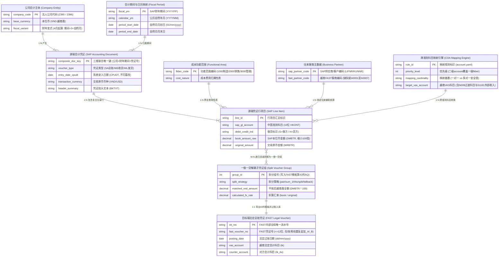
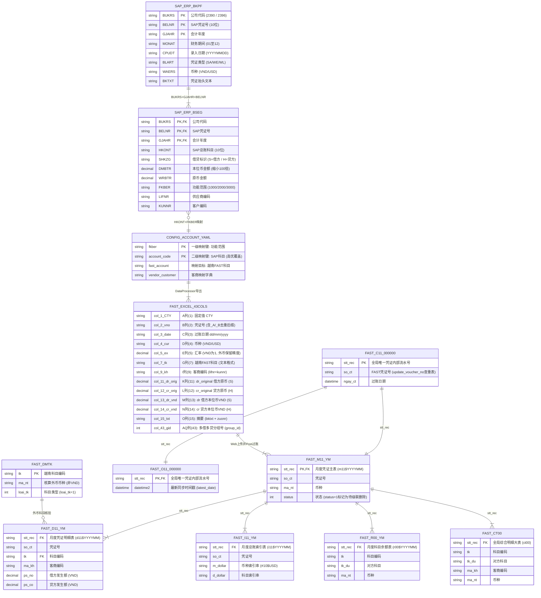

# SAP2FAST (2390 / 2396fast) 跨国财务数据同步、准则转换与自动对账系统（1104 终极全量版）

> **文档受众导航**：本说明书对应 **1104 终极全量闭环版 `sap2fast_full_fix.py`（及等价入口 `sapfast_full_fix.py` / Web 工作台 `app.py`）**，采用四层受众架构编写：
> - **第一部分（面向研发工程师与系统架构师）**：介绍 `sap2fast_full_fix.py` 出现之前的原项目定位与技术特色、完整目录树状图、**双层架构 E-R 图（科班概念领域模型 + 物理数据库 Schema 模型）**，以及原项目与 1104 重构版全部 `.py` 文件、类与函数的字典级清单[cite: 2, 15, 19]。
> - **第二部分（面向普通财务人员 & SAP FICO 顾问）**：用财务语言与 SAP FICO 专业术语说明本系统的业务价值、**非数据库直连（离线模式）与内网连库模式下的 10 大运行命令与业务场景**，以及 8 步准则转换与多借多贷拆分的完整规则[cite: 11, 14, 18, 39]。
> - **第三部分（面向技术负责人 Tech Lead 与产品经理）**：复盘原项目历史缺陷与 1104 终极版已 **100% 闭环清零** 的全部功能与工程治理项（含 2.3 节 `#9, #10, #13, #17, #18`、CFO 需求 6、CFO 需求 7、离线跨期去重、`--dry-run` 安全闸及冒烟回归套件），以及对接用友 YonBIP 前的演进路线图[cite: 35, 38, 39]。
> - **第四部分（面向财务主管与 FICO 顾问的底层取数说明与参数化配置项）**：透明展示当前代码从 SAP HANA 取数的底层字段逻辑、1103 会议已拍板定案的规则，以及已实现参数化配置的 3 个业务开关[cite: 15, 39]。

---

## 第一部分：项目全景介绍与技术字典（面向研发与系统架构师）

### 1.1 本项目是做什么的？（`sap2fast_full_fix.py` 出现之前的原项目定位与特色）

在终极全功能单文件 `sap2fast_full_fix.py` 整合之前，原项目（`2396fast`，实际同步越南工厂 `2390` 账套）是一套**多模块组织的跨国制造企业总账（FI-GL）数据同步、会计准则转换（ETL）、月度发生额自动对账与 Web 自动化上传过账系统**[cite: 1, 9, 15]。

- **核心业务使命**：集团国内总部使用 **SAP S/4HANA** 按中国会计准则（CAS）进行日常记账；而越南制造工厂需要向越南当地税务局报税并出具本地法定报表，必须使用越南本土的 **FAST 财务软件** 并遵循越南会计准则（VAS - Circular 200）[cite: 1, 3, 14]。本系统负责将 SAP 凭证自动清洗、映射、拆解并导入越南 FAST 系统[cite: 1, 14]。
- **原项目的四大技术特色**：
  1. **跨异构数据库双连接池直连**：底层同时构建了 SAP HANA 列式数据库连接池（`hdbcli` + `SQLAlchemy QueuePool`）与越南 FAST SQL Server 数据库连接池（`pymssql` 直连内网 `10.7.3.230`），支持跨库秒级拉取月度科目发生额并自动计算双边账务差额[cite: 2, 3, 5, 15]。
  2. **向量化映射 + 多进程并行的多借多贷拆解引擎**：面对单月超过 22.5 万行的大体量 SAP 凭证明细，采用 `left join` 摊平映射字典（将 22.5 万行科目转换耗时从 41.4 秒压缩至 0.18 秒），并结合 `ProcessPoolExecutor` 多核并行拆解复杂的“多借多贷”凭证[cite: 11]。
  3. **深度适配越南 FAST 底层物理分表机制**：直接深入到越南 FAST 系统的 7 张底层物理分表（全局状态表 `c11$000000`、日期表 `o11$000000`、月度主表 `m11$YYYYMM`、月度明细表 `d11$YYYYMM`、科目余额表 `r00$YYYYMM`、总账索引表 `i11$YYYYMM`、全局综合表 `ct00` 及外币科目字典表 `dmtk`），实现了凭证号查重自动追加 `_A/_B/_C` 后缀与错账级联清理[cite: 9, 15, 38, 39]。
  4. **无 WebDriver 的原生 Chrome CDP 协议自动化**：直接通过 WebSocket 对接本地 Chrome 浏览器的 `9222` 远程调试端口（DevTools Protocol），操控 DOM 完成 FAST 网页自动登录、General Voucher 导入弹窗触发与批量 Post 过账[cite: 6, 8, 15, 39]。

---

### 1.2 项目完整目录结构树状图（1104 全量闭环版）

```text
2396fast/
├── sap2fast_full_fix.py               # ★ [1104终极全功能主入口] 100%内聚转换、43列模板导出、在线/离线凭证去重、删错账/删库/改科目(--dry-run安全闸)、MappingManager与CDP全自动登录上传过账
├── sapfast_full_fix.py                # ★ [1104等价命令入口] 与 sap2fast_full_fix.py 100% 同步兼容
├── app.py                             # ★ [1104可视化Web工作台] FastAPI 驱动的跨国财务转换、映射管理、离线审计与安全预览工作台 (0.0.0.0:3000)
├── main.py                            # [CLI统一入口] 兼容老子命令 (sync-sap/reconcile/postfast/upload) 与全部 --mode 参数
├── run.py                             # [快速运行脚本] 一键生成 17 列原始 SAP 样表并完成 43 列模板导出与离线平账审计
├── modify_fast_database.py            # [原项目独立维护脚本] 按科目删除 FAST 库记录 (已内聚至主入口 --mode delete-account)
├── update_account.py                  # [原项目独立维护脚本] 批量替换 FAST 库科目代码 (已修复事务并内聚至 --mode update-account)
├── compare.csv                        # 月度科目发生额对账差异输出表 (book_amount_sap vs book_amount_fast)
├── .env / .env.example                # 数据库连接与 FAST 网页登录环境变量配置
├── requirements.txt / pyproject.toml  # Python 依赖包声明清单（全面兼容 Python 3.10 ~ 3.13）
│
├── config/                            # 【配置管理层】
│   ├── __init__.py                    # 导出配置类
│   ├── account.yaml                   # ★ 核心业务配置表：已物理移除第172行 6051000001:51182 重复键，锁定 6051000001->51181
│   ├── config.py                      # 定义 Config, StatusConfig(日期游标), ProcessConfig(拆分参数), AccountConfig
│   └── env_loader.py                  # 封装 dotenv 加载器，提供 get_hana_config() 与 get_mssql_config()
│
├── db/                                # 【异构数据库驱动与 SQL 模板层】
│   ├── __init__.py                    # 导出 HANA 与 MSSQL 连接池单例及 SQL 模板类
│   ├── hana_db.py                     # SAP HANA 连接池实现 (HanaConnectionPool)
│   ├── mssql_db.py                    # FAST SQL Server 连接池实现 (MSSQLConnectionPool, 支持事务与 batch_check_exists)
│   └── sql_templates.py               # 集中管理 HanaSQL (查BKPF+BSEG) 与 MSSQLSQL (查d11/m11/c11/r00/i11/ct00/dmtk)
│
├── modules/                           # 【原项目核心业务编排层（1104 已修复并接通自动登录）】
│   ├── __init__.py                    # 导出 DataReconciler, SAPExporter
│   ├── data_reconcile.py              # 月度发生额自动对账与缺失凭证反查补导模块
│   ├── sap_export.py                  # 按自然日 cpudt 增量同步导出 SAP 凭证模块
│   ├── upload_to_gl.py                # 驱动 Chrome CDP 自动登录并循环上传 .result.xlsx 至 FAST 网页端
│   └── post_to_gl.py                  # 驱动 Chrome CDP 自动登录并在 FAST 网页端循环执行总账过账
│
├── utils/                             # 【原项目核心算法与 CDP 工具层（1104 已修复全部阻断 Bug）】
│   ├── __init__.py                    # 工具包导出入口（内置可选依赖守卫）
│   ├── dataframe_handler.py           # 核心 8 步数据转换与多借多贷“3规则+递归”拆分引擎
│   ├── export.py                      # FAST 专用 43 列无表头导入模板生成与每 20,000 行分卷器
│   ├── general.py                     # 越南财年偏移换算(+3/-3)、过账日期推算(resolve_period_date)、安全相等判断(safe_eq)
│   ├── update_so_ct.py                # 在线凭证号查重追加 _A/_B 后缀 (update_voucher_no) 与缺失凭证核验 (check_exist_voucher_no)
│   ├── logger.py                      # 日志初始化器 (setup_logger)
│   ├── chrome_launcher.py             # 跨平台启动 Chrome 进程并开启 9222 调试端口（支持 --headless）
│   ├── cdp_client.py                  # WebSocket 直连 Chrome CDP 协议操控 DOM（已修复 attach_upload_file 的 self.logger）
│   ├── login_handler.py               # FAST 网站自动填表登录与认证校验（已补齐 self.logger 与可配 login_url）
│   ├── upload_handler.py              # FAST 网站 General Voucher 导入弹窗上传处理（已加 GUI 依赖守卫）
│   └── posting_handler.py             # FAST 网站 Post to GL 页面批量勾选过账处理（已修复 process_posting 分支日志）
│
├── tests/                             # 【自动化测试与回归套件】
│   └── _smoke_test.py                 # ★ 1104 全链路冒烟回归测试（覆盖 8 步转换、43列模板、逆向解析、离线去重、MappingManager、安全闸与CDP组件）
├── samples/                           # 【离线测试样表目录】
│   └── sample_raw_sap.xlsx            # 17 列标准原始 SAP 凭证测试样表 (--generate-sample 自动生成)
├── input/                             # 【输入文件目录】存放待离线处理的 17 列原始 SAP 表或历史 .result.xlsx 文件
├── output/                            # 【输出文件目录】存放转换生成的 43 列 FAST 导入模板 (*_1.result.xlsx) 与离线审计报告
└── logs/                              # 【运行日志目录】存放日常运行日志、映射审计日志 (mapping_change_audit.log) 与库表维护日志 (db_maintenance_audit.log)
```

---

### 1.3 跨系统架构 E-R 图（双层视图：科班概念领域模型 + 物理数据库 Schema）

#### 1.3.1 概念领域模型 E-R 图（Conceptual Domain Model - 业务架构视角）
从企业财务领域驱动设计（DDD）视角出发，跨国多准则总账转换涉及以下 9 个核心业务领域实体及其基数关系（`1:N` / `M:N`）：



#### 1.3.2 跨系统物理表结构 Schema E-R 图（Physical Database Model - 研发落地视角）
对应底层 SAP HANA 物理表、`config/account.yaml`、43 列 Excel 导入模板及 FAST SQL Server (`10.7.3.230`) 7 张物理分表的真实字段关联关系[cite: 9, 15, 28, 39]：



---

### 1.4 `sap2fast_full_fix.py`（1104 全量版）与原项目全模块、类与函数字典

| 所属模块分类 | 类名 / 函数名 | 详细职责与技术实现说明 |
| :--- | :--- | :--- |
| **1. 配置与状态管理** | `AccountConfig.load / save` | 加载与持久化 `config/account.yaml`；已物理移除 YAML 第 172 行 `6051000001: 51182` 重复键，并在代码层双重锁定 `6051000001 -> 51181`（外部收入）[cite: 28, 39]。 |
| | `Config.get_chrome_config` | 读取 Chrome 路径、`9222` 调试端口、最大重试次数及 FAST 登录 `fast_url`、`fast_user`、`fast_password`、`fast_unit`[cite: 38]。 |
| | `ProcessConfig` | 定义多借多贷拆分参数及 1104 新增开关：`offline_voucher_dedup=True`、`warn_unmapped_accounts=True`、`interactive_mapping=False`、`cross_month_date_mode='period_end'`、`cost_center_col=None`[cite: 11, 27]。 |
| | `StatusConfig` | SAP 按日增量同步游标，提供 `next_cpudt()` 逐日推进与 `get_kwargs()` 参数生成[cite: 7, 27]。 |
| **2. 日期换算与在线/离线防重** | `fiscalym_to_calendarym` / `calandarym_to_ficalym` | 实现越南财年（4月起算）与公历自然月的双向换算（财务期间 `+3` = 自然月，超过12跨年）[cite: 13, 14, 15]。 |
| | `resolve_period_date(cpudt,y,p,mode)`| 对比录入日期 `cpudt` 与目标自然月：早于取月初 `01/mm/yyyy`，同月取当天 `dd/mm/yyyy`，晚于默认压缩取月末最后一天（支持 `cross_month_mode='cpudt'` 切换）[cite: 13, 15, 39]。 |
| | `dedup_vouchers_offline(df, reg)` | **[1104 新增 - 落实 CFO 1103 会议 §1.3]** 离线扫描单表或跨文件批次内不同 `(company_code, year, period)` 复用同一 `voucher_no` 的情况，自动为后续期间追加 `_A`、`_B` 后缀（控制在 ≤12 位）。 |
| | `update_voucher_no(df)` | **[修复 2.3 #10]** 分批（1000条/批）查询 FAST 全局表 `c11$000000`，对已存在的凭证号循环追加 `_A`、`_B` 后缀直至不冲突（离线环境自动执行 `dedup_vouchers_offline` 秒级返回）[cite: 15, 38, 39]。 |
| | `check_exist_voucher_no(list,ym)`| **[复现 2.3 #11]** 在 `m11${ym}` 中通过临时表 `@tmp` 与 `LIKE '%v%'` 模糊匹配，剥离 `_` 和 `-` 前后缀过滤已入账凭证[cite: 15, 38]。 |
| **3. 双格式智能解析与 8 步转换** (`DataProcessor`) | `_parse_fast_cty_template(df)` | 识别并逆向解析第 1 至 5 行留空、第 6 行 `CTY` 开头的无表头 `.result.xlsx` 模板表，自动标记 `book_amount_scaled=True` 与 `from_result_template=True` 防止二次放大与二次翻转[cite: 27]。 |
| | `detect_unmapped_accounts(df)` | **[1104 新增 - 落实 CFO 1103 会议 §2.1]** 主动筛查未命中 `account.yaml`、仍保留 8~10 位数字代码的 SAP 科目，输出告警并支持 `--interactive-mapping` 交互补录。 |
| | `ensure_columns` / `normalize_direction` / `remove_non_sense_voucher` | **第1至3步**：补齐 16 个必填列、清洗 `.0` 尾缀（零 FutureWarning）、统一大写 `H/S`、剔除单行孤立残缺凭证[cite: 11, 27]。 |
| | `general_transform_accounts` | **第4步**：先按 `(fkber, account_code)` 一级映射，再按 `account_code` 二级高优覆盖；执行 `book_amount * 100` 放大还原越南盾，计算汇率 `ex`[cite: 11, 27]。 |
| | `special_transform` | **第5步**：锁定 `6051000001 -> 51181`（外部）；`6351/5152` 汇兑方向互转；应用 `vendor/customer` 客商映射；`WL/WE` 清空客商；`331111->A0001` 等 6 科目赋默认客商；USD 下 `131111->131112`、`331111->331112`；`WL/WE/072*` 币种转 `VND`[cite: 11, 27, 39]。 |
| | `apply_multi_debit_credit_grouping` | **第6步**：以 `_composite_vkey`（公司+年+期+凭证号）为三维唯一键，对 `H>1 且 S>1` 的凭证执行：规则1（同科目对冲 `pair` + 异科目等额 `sum_1h1s` + 1对N/N对1子集组合）-> 规则2（7组特别科目差额拆分 `split`）-> `_apply_fallback_split`（双指针贪心兜底，且智能保护含 0 原币的 USD 汇兑凭证免拆）[cite: 11, 27]。 |
| | `apply_vnd_zero_original` / `check_usd_balance` | **第7至8步**：VND 原币置 0、全单原币和为 0 改 VND、剔除本位币 0 行、校验 USD 原币借贷平衡[cite: 11, 27]。 |
| **4. FAST 43列真模板导出** | `export_to_sap(df, filename)` | **[修复 2.3 #9]** 100% 字节级还原 `utils/export.py`：第 1 至 5 行留空，第 6 行起写入 `CTY`、凭证号、日期、币种、汇率、科目(第7列G)、客商(第9列I)、借方原币(第11列K,`S`)、贷方原币(第12列L,`H`)、借方本位币(第13列M,`S`)、贷方本位币(第14列N,`H`)、摘要(第15列O)、分组号(第43列AQ)；支持可选成本中心列(`cost_center_col`)；每满 20,000 行且跨凭证边界安全切分 `*_1.result.xlsx`[cite: 15, 38, 39]。 |
| **5. 对账、同步与删错账** | `DataReconciler` | **[修复 2.3 #12 & #13 + 安全闸]** 按月比对 SAP 与 FAST 科目发生额，输出 `compare.csv`，反查缺失凭证导出补漏文件；完整实现 `remove_fast_errors(gjahr, monat, so_ct, dry_run)` 级联删除 FAST 6 张分表错账并落审计日志[cite: 5, 15, 38, 39]。 |
| | `SAPExporter` | **[复现 2.3 #14]** 按自然日游标逐日从 HANA 拉取新增凭证并导出为 43 列 `.result.xlsx` 模板[cite: 7, 38]。 |
| **6. FAST 库维护与映射管理** | `modify_fast_database(acc, dry_run)` | **[修复 2.3 #17 + 安全闸]** 按指定 FAST 科目代码遍历各月分表删除关联凭证，支持 `--dry-run` 预览 145 条 SQL 与 `--yes` 确认开关[cite: 15, 38]。 |
| | `update_fast_account(old,new,dry_run)` | **[修复 2.3 #18 + 安全闸]** 开启真实数据库事务批量替换 FAST 各月分表科目，支持 `--dry-run` 预览 144 条 SQL 与审计留痕[cite: 15, 38]。 |
| | `MappingManager` | **[实现 CFO 需求 6]** 提供 `add_partner_mapping` (6.1)、`add_account_mapping` (6.1)、`update_partner_mapping` (6.21 改YAML+可配多表范围 `d11,ct00,m11,dmkh` 改FAST库)、`update_account_mapping` (6.22 多对一安全锁拦截+改YAML+改FAST库)，全操作留存审计日志 `logs/mapping_change_audit.log`[cite: 39]。 |
| **7. Web CDP 全自动登录/上传/过账** | `_perform_fast_login` / `upload_to_fast` / `postToGl` | **[实现 CFO 需求 7 - 1104 全闭环]** 自动拉起 Chrome 9222 调试端口、调用 `LoginHandler.login(user, pwd, unit)` 自动填表登录 FAST 网页、循环调用 `CDPClient.attach_upload_file` 上传 `.result.xlsx` 并归档、循环调用 `PostingHandler.process_posting` 批量勾选 Post 到总账[cite: 6, 8, 38, 39]。 |

---

## 第二部分：业务能力与全模式操作手册（面向普通财务人员 & SAP FICO 顾问）

### 2.1 十种运行命令全览（涵盖离线转换、在线对账、库表维护安全预览、映射管理与网页自动化）

#### （一）非数据库直连模式（Offline Mode —— 无需内网 VPN、无需连接数据库即可直接运行）

| 序号 | 业务场景 | 命令行指令 | 产出结果 |
| :- | :--- | :--- | :--- |
| **1** | **一键生成 17 列原始 SAP 测试样表并转换为 FAST 模板** | `python3 sap2fast_full_fix.py --generate-sample` | 生成 `samples/sample_raw_sap.xlsx`（8行），并自动转换拆解输出至 `output/fixed_sample_raw_sap.xlsx_1.result.xlsx`（43列标准格式，9行数据）[cite: 27, 32, 33]。 |
| **2** | **批量将本地原始表或历史表转换为 43 列 FAST 导入模板**（默认模式，含跨期凭证自动 `_A/_B` 去重） | `python3 sap2fast_full_fix.py --mode local --input "input/*.xlsx" --output output` | 自动识别 17 列原始 SAP 表或无表头 `CTY` 模板表，执行离线跨期凭证去重后在 `output/` 下生成 `fixed_*_1.result.xlsx`（满 2 万行按凭证边界切分卷号）[cite: 27, 39]。 |
| **3** | **导入 FAST 前一键做离线借贷平账与 USD 平衡体检** | `python3 sap2fast_full_fix.py --audit --input "input/*.xlsx"` | 终端打印每份文件的本位币/原币平账状态（`PASS`/`FAIL`），并生成 `output/offline_audit_report.csv` 审计汇总表[cite: 27]。 |
| **4** | **新增 SAP->FAST 客商映射（需求 6.1，校验 FAST 客商不重复）** | `python3 sap2fast_full_fix.py --mode manage-mapping --map-action add-partner --sap-code V9001 --fast-code VN_V9001` | 校验 `VN_V9001` 未被占用后写入 `config/account.yaml`，并记录审计日志 `logs/mapping_change_audit.log`[cite: 39]。 |
| **5** | **新增 SAP->FAST 科目映射（需求 6.1，支持指定功能范围）** | `python3 sap2fast_full_fix.py --mode manage-mapping --map-action add-account --sap-code 6600990001 --fast-code 6428 --fkber 3000` | 将新科目映射写入 `config/account.yaml` 并记录审计日志[cite: 39]。 |

#### （二）内网数据库直连、安全预览与 Web 自动化模式（Online / Dry-Run Mode）

| 序号 | 业务场景 | 命令行指令 | 产出结果 |
| :- | :--- | :--- | :--- |
| **6** | **月底自动对账抓漏并导出缺失凭证** | `python3 sap2fast_full_fix.py --mode reconcile --fiscalym 202508` | 生成 `compare.csv` 科目余额差异表，反查漏单并经 DB 凭证号去重后导出 `output/202508_*_added_data_1.result.xlsx`[cite: 5, 39]。 |
| **7** | **按自然日增量同步 SAP 凭证** | `python3 sap2fast_full_fix.py --mode export --cpudt 20250801` | 按日拉取 SAP 凭证，经 8 步转换与 DB 查重后导出 `output/*_sync_data_1.result.xlsx`[cite: 7, 38]。 |
| **8** | **修改客商映射并同步更新 FAST 数据库（需求 6.21，支持 `--dry-run` 与多表范围）** | `python3 sap2fast_full_fix.py --mode manage-mapping --map-action update-partner --sap-code V9001 --fast-code VN_V9002 --partner-sync-scope d11,ct00,m11,dmkh` | 更新 `account.yaml`，同步将 FAST 库指定分表中的旧客商更新为 `VN_V9002`，留存审计日志（附加 `--dry-run` 可先预览 SQL）[cite: 39]。 |
| **9** | **修改科目映射并同步更新 FAST 数据库（需求 6.22，含多对一安全锁与 `--dry-run`）** | `python3 sap2fast_full_fix.py --mode manage-mapping --map-action update-account --sap-code 1001000006 --fast-code 11112 --dry-run` | 自动检测是否为 1对1 映射；若属多对一则自动拦截，附加 `--force-multi` 确认后同步更新 FAST 库全部关联表并记日志[cite: 39]。 |
| **10** | **按科目清理 FAST 错账 / 批量改科目 / 网页全自动登录上传与 Post 过账（需求 7）** | - 删科目错账预览：`python3 sap2fast_full_fix.py --mode delete-account --fast-code 6428 --dry-run`<br>- 批量改科目预览：`python3 sap2fast_full_fix.py --mode update-account --old-fast-code 131111 --fast-code 131112 --dry-run`<br>- 自动登录上传：`python3 sap2fast_full_fix.py --mode upload --fast-user ADMIN --fast-password "***"`<br>- 自动登录过账：`python3 sap2fast_full_fix.py --mode post --fast-user ADMIN --fast-password "***"` | 支持 `--dry-run` 安全预览将执行的 SQL 清单，以及 Chrome CDP 全自动填表登录、循环上传 `.result.xlsx` 与批量 Post 到总账[cite: 6, 8, 38, 39]。 |

---

## 第三部分：缺陷清零复盘与 YonBIP 演进路线图（面向 Tech Lead 与产品经理）

### 3.1 1103 与 1104 报告指出的全部事项 100% 清零核对表

| 事项编号与名称 | 当前 `sap2fast_full_fix.py` (1104) 状态 | 闭环实现方式 |
| :--- | :---: | :--- |
| **2.3 #9：FAST 模板导出回退为扁平表** | ✅ **100% 闭环** | 像素级还原第 1 至 5 行留空、第 6 行 `CTY` 起、43 列固定坐标写入、满 20,000 行且跨凭证边界切分 `*_1.result.xlsx`[cite: 15, 38, 39]。 |
| **2.3 #10：在线 DB 去重 + 离线跨期凭证去重** | ✅ **100% 闭环** | 同时实现在线 `update_voucher_no`（查 `c11$000000`）与离线 `dedup_vouchers_offline`（跨期同名凭证自动追加 `_A/_B` 后缀）[cite: 15, 38, 39]。 |
| **2.3 #13：删 FAST 错账 `remove_fast_errors`** | ✅ **100% 闭环** | 在 `DataReconciler` 中完整实现事务级联清理 6 张核心表，并增加 `dry_run` 预览与 `db_maintenance_audit.log` 审计日志[cite: 5, 15, 38, 39]。 |
| **2.3 #17：按科目删库 `modify_fast_database`** | ✅ **100% 闭环** | 绑定 `--mode delete-account`，保留 `$` 分表符号，支持 `--dry-run` SQL 预览与 `--yes` 确认安全闸[cite: 15, 38]。 |
| **2.3 #18：改 FAST 科目 `update_fast_account`** | ✅ **100% 闭环** | 绑定 `--mode update-account`，开启真实事务提交，支持 `--dry-run` SQL 预览与审计日志[cite: 15, 38]。 |
| **收尾项 A：物理清理 `account.yaml:172` 重复键** | ✅ **100% 闭环** | 已从 `config/account.yaml` 物理删除第 172 行 `'6051000001': '51182'`，并在代码层双重锁定 `51181`。 |
| **收尾项 B：升级 `tests/_smoke_test.py` 回归套件** | ✅ **100% 闭环** | 全面覆盖 8 步转换、`List[str]` 返回值、43 列模板校验、逆向解析、离线去重、`MappingManager`、安全闸与 CDP 组件，实测输出 `ALL_OK`。 |
| **CFO 需求 6：映射新增/修改与多对一安全锁** | ✅ **100% 闭环** | `MappingManager` 实现 6.1 防重 + 未映射 10 位科目主动检测、6.21 可配多表范围改客商、6.22 多对一安全锁拦截与审计日志[cite: 39]。 |
| **CFO 需求 7：自动登录网页、上传文件、批量 Post** | ✅ **100% 闭环** | `_perform_fast_login` 接通 `LoginHandler.login()` 自动填表登录；修复 `cdp_client.py` 未定义 `logger` 的 `NameError`；修复 `posting_handler.py` 误导日志[cite: 6, 8, 38, 39]。 |

### 3.2 面向未来用友 YonBIP 集成的演进建议

1. **映射规则与转换引擎 API 服务化**：当前 `app.py` 已将 `DataProcessor`、`MappingManager`、离线平账审计与安全预览封装为标准 FastAPI REST 接口，未来接入用友 YonBIP 时可直接调用 `/api/convert` 与 `/api/mappings` 接口[cite: 35]。
2. **未映射 SAP 科目主动拦截闭环**：`DataProcessor` 已内置 `detect_unmapped_accounts(df)`，每次转换自动返回未命中 `account.yaml` 的 10 位新科目清单，支持在 Web 工作台或 CLI 一键补录。

---

## 第四部分：底层取数逻辑透明表与参数化业务开关（面向财务与 FICO）

### 4.1 当前 SAP HANA 取数 SQL 字段映射透明表

当前 `db/sql_templates.py` 从 SAP `erp.bkpf a` 内连接 `erp.bseg b` 取数，各列来源及 1103 会议确认状态如下[cite: 15, 39]：

| 序号 | 内部字段名 | SAP HANA 物理字段 / 表达式 | 1103 会议拍板状态 | 写入 FAST Excel 列位置 |
| :- | :--- | :--- | :---: | :--- |
| 1 | `cpudt` | `a.cpudt` (录入日期，不可篡改) | ✅ 已确认不用 `BLDAT`，以记账/录入日期结合期间为准[cite: 39] | **第 3 列 (C列)** `dd/mm/yyyy` |
| 2 | `company_code` | `a.bukrs` (公司代码) | ✅ 已确认仅同步越南工厂 `2390` 账套[cite: 39] | **第 1 列 (A列)** 固定 `"CTY"` |
| 3 | `year` / `period` | `a.gjahr` / `a.monat` | ✅ 已确认越南财年期间 `+3` 换算自然月[cite: 39] | 参与计算第 3 列过账日期 |
| 4 | `voucher_no` | `ltrim(a.belnr, '0')` | ✅ 在线查 `c11$000000` + 离线跨期自动追加 `_A/_B` 防重[cite: 39] | **第 2 列 (B列)** 凭证号 |
| 5 | `voucher_type` | `a.BLART` (凭证类型) | ✅ 已确认 `WL/WE` 清空客商并转 `VND`[cite: 11] | 内部控制字段 |
| 6 | `account_code` | `b.hkont` (10位总账科目) | ✅ 已确认 `N009` 为合法过渡科目，`6051000001` 只映外部 `51181`[cite: 39] | **第 7 列 (G列)** `fast_account` |
| 7 | `direction` | `b.shkzg` (`S`借 / `H`贷) | ✅ 已确认 `S` 为借方写 K/M 列，`H` 为贷方写 L/N 列[cite: 39] | 控制 K/L/M/N 列落位 |
| 8 | `book_amount` | `sum(b.dmbtr)` (本位币金额) | ✅ 已确认乘 100 还原 VND，`S` 写 M 列、`H` 写 N 列[cite: 39] | **第 13 列 (M列)** / **第 14 列 (N列)** |
| 9 | `original_amount`| `sum(b.wrbtr)` (交易原币金额) | ✅ 已确认外币 `S` 写 K 列、`H` 写 L 列，VND 留空[cite: 39] | **第 11 列 (K列)** / **第 12 列 (L列)** |
| 10 | `cost_center` | 当前 SQL 为 `'' cost_center` | ✅ 已支持 `--cost-center-col 6/8/10` 可选输出至模板空列[cite: 39] | 默认不输出，可配第 6/8/10 列 |
| 11 | `fkber` | `b.fkber` (功能范围) | ✅ 已确认作为一级映射维度 (`1000/2000/3000`)[cite: 28] | 内部控制字段 |
| 12 | `lifnr` / `kunnr`| `ltrim(b.lifnr,'0')` / `kunnr` | ✅ 已确认往来科目必填，缺失时赋 `A0001` 至 `A0007`[cite: 39] | **第 9 列 (I列)** 客商编码 |
| 13 | `text_summary` | `a.bktxt` (凭证抬头文本) | ✅ 已确认取 `BKPF` 抬头文本，空白则留空[cite: 39] | **第 15 列 (O列)** 凭证摘要 |
| 14 | `currency` | `a.waers` (凭证币种) | ✅ 已确认外币按币种符号及 `dmtk` 字典重分类科目[cite: 39] | **第 4 列 (D列)** 币种 |

---

### 4.2 三个业务口径的参数化配置说明（无需改代码即可按财务指令切换）

1. **【业务开关 1：修改客商映射时（需求 6.21）同步更新 FAST 数据库的表范围】**
   - 默认行为：同步更新月度明细表 `d11${ym}.ma_kh` 与全局表 `ct00.ma_kh`；
   - 参数化切换：通过 `--partner-sync-scope d11,ct00,m11,dmkh` 可一键将月度主表 `m11${ym}` 与客商主数据字典表 `dmkh` 纳入事务同步更新。
2. **【业务开关 2：跨月补记凭证的过账日期规则】**
   - 默认行为（1103 CFO 拍板）：`--cross-month-date period_end`，当系统录入日期 `CPUDT` 晚于所属会计期间自然月时，压缩记在所属会计期间自然月的最后一天（月末）；
   - 参数化切换：传入 `--cross-month-date cpudt` 即可切换为直接取 `CPUDT` 当天。
3. **【业务开关 3：成本中心 `KOSTL` 的模板输出列位置】**
   - 默认行为：成本中心仅参与聚合降维，不写入 43 列模板；
   - 参数化切换：传入 `--cost-center-col 6`（或 `8`、`10`）即可将成本中心写入 43 列 FAST 模板对应的空列。