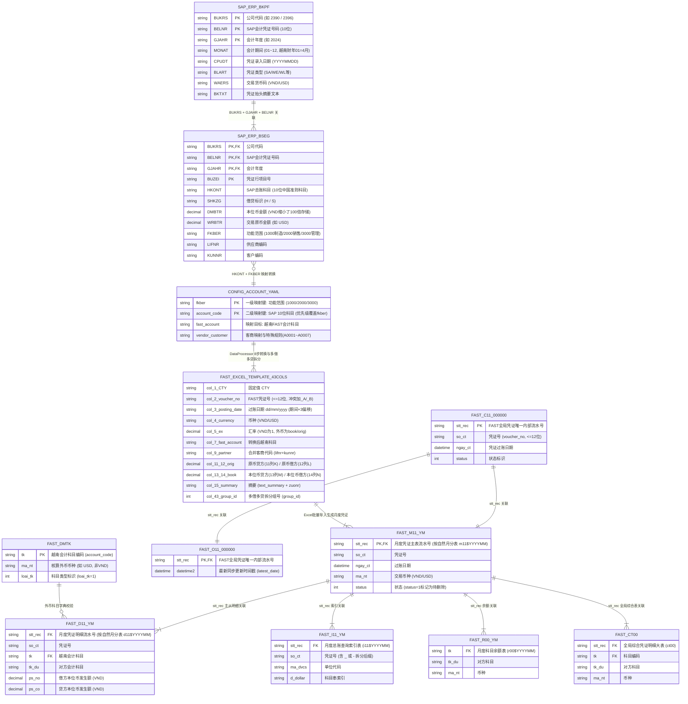

# SAP2FAST (2396fast) 跨国财务数据同步、准则转换与自动对账系统

> **文档导读**：本 README 分为 **四个核心部分**，分别面向不同角色的读者：
> - **第一部分（面向研发与架构师）**：介绍本项目在 `sap2fast_full_fix.py` 出现之前的原始定位、技术特色、完整目录树状图、跨系统数据库 **E-R 实体关系图**，以及原项目与重构版全部 `.py` 文件、类与函数的逐一字典级罗列[cite: 2, 15, 19]。
> - **第二部分（面向普通财务人员 & SAP FICO 顾问）**：用财务语言与 SAP 专业术语说明本项目到底能做什么、8 步准则转换与多借多贷拆分的专业逻辑，以及日常如何使用[cite: 11, 14, 18]。
> - **第三部分（面向技术负责人与产品经理）**：客观剖析原项目的历史缺陷、当前重构版已解决的问题、以及未来的提升空间与待开发项目清单[cite: 15, 16, 19]。
> - **第四部分（面向财务主管与 FICO 顾问的取数审计清单）**：详细拆解当前代码到底是从 SAP 哪张表哪个字段取数、存在哪些严重的 **SAP 会计逻辑隐患（如 `BKPF+BSEG` 按科目 `GROUP BY` 合并行、借贷方向 `S/H` 定义、公司代码 `2390/2396` 混用等）**，以及需要财务与 FICO 顾问明确拍板的业务规则清单[cite: 3, 11, 14]。

---

## 第一部分：项目全景介绍与技术字典（面向研发与系统维护人员）

### 1.1 本项目是做什么的？（`sap2fast_full_fix.py` 出现之前的原项目定位与特色）

在单文件重构版 `sap2fast_full_fix.py` 出现之前，原项目（`2396fast`）是一套**多模块组织的跨系统财务总账（GL）自动化同步与对账工程**[cite: 1, 9, 15]。

- **核心使命**：解决跨国制造企业（国内总部使用 **SAP S/4HANA** 按中国会计准则记账，越南工厂使用本地 **FAST 财务软件** 按越南会计准则报税与出表）之间的**总账凭证自动搬运、会计科目跨准则映射、复杂分录拆解、月度科目余额自动对账与网页端自动上传过账**问题[cite: 1, 3, 9, 14]。
- **原项目的四大技术特色**：
  1. **跨异构数据库双连接池直连**：同时内置 SAP HANA 列式数据库（`hdbcli + SQLAlchemy QueuePool`）与越南 FAST 底层 SQL Server 数据库（`pymssql` 连接 `10.7.3.230`）双连接池，支持跨库秒级拉取月度科目发生额并自动比对差异[cite: 2, 3, 5, 15]。
  2. **向量化 + 多进程并行的多借多贷拆分引擎**：针对 22 万行以上的大体量月度凭证（见 `logs/timing.log` 中的 `225,572` 行记录），原项目在 `utils/dataframe_handler.py` 中摒弃了低效的 `DataFrame.apply`，采用 `left join` 摊平映射表（将 22 万行科目映射耗时从 41 秒压降至 0.18 秒）+ `ProcessPoolExecutor` 多核并行拆分多借多贷凭证[cite: 11]。
  3. **完全贴合越南 FAST 底层表结构的防重与對账机制**：深入到了越南 FAST 软件的底层物理分表（如 `c11$000000` 全局凭证表、`m11${ym}` 月度主表、`d11${ym}` 月度明细表、`i11${ym}` 总账索引表、`dmtk` 外币科目字典表），实现了入库前凭证号冲突自动追加 `_A/_B/_C` 后缀去重[cite: 9, 15]。
  4. **原生 CDP 协议浏览器自动化（零 WebDriver 依赖）**：在 `utils/cdp_client.py` 中未依赖臃肿的 Selenium，而是直接通过 `websocket-client` 与 `requests` 对接 Chrome DevTools Protocol (`9222` 端口) 控制 FAST 网页端上传 Excel 并执行过账[cite: 6, 8, 15]。

---

### 1.2 项目完整目录结构树状图

```text
2396fast/
├── sap2fast_full_fix.py               # ★ [终极重构版主入口] 自包含全量转换、模板导出、对账、审计与CLI
├── main.py                            # [原项目CLI入口] 含 sync-sap/reconcile/postfast/upload 四个子命令(原代码有未导入Bug)
├── run.py                             # [原项目调试入口] 硬编码跑 DataReconciler('202408') 或读取 converted_result.xlsx
├── modify_fast_database.py            # [原项目独立维护脚本] 按指定越南科目代码级联删除 FAST 库 2024-2025 年所有月份分表数据
├── update_account.py                  # [原项目独立维护脚本] 交互式批量替换 FAST 库中历史月份的旧科目代码为新科目代码
├── update_account.spec                # PyInstaller 打包配置文件（用于将 update_account.py 打包为 exe）
├── compare.csv                        # 月度科目发生额对账差异输出表 (SAP发生额 vs FAST发生额)
├── .env / .env.example                # 数据库连接环境变量配置 (HANA_HOST / MSSQL_HOST=10.7.3.230 等)
├── requirements.txt / pyproject.toml  # Python 依赖包声明清单与 uv 项目配置
│
├── config/                            # 【配置管理层】
│   ├── __init__.py                    # 导出 Config, StatusConfig, ProcessConfig, AccountConfig, EnvConfig 等
│   ├── account.yaml                   # ★ 核心业务配置表：包含 account(174条普通科目映射) 与 fkber(1000/2000/3000功能范围映射)
│   ├── config.py                      # 定义 Config, StatusConfig(日期游标), ProcessConfig(拆分参数), AccountConfig 单例
│   └── env_loader.py                  # 封装 dotenv 加载器，提供 get_hana_config() 与 get_mssql_config()
│
├── db/                                # 【异构数据库驱动与 SQL 模板层】
│   ├── __init__.py                    # 导出 HANA 与 MSSQL 连接池单例及 SQL 模板类
│   ├── hana_db.py                     # SAP HANA 连接池实现 (HanaConnectionPool, 基于 hdbcli + SQLAlchemy QueuePool)
│   ├── mssql_db.py                    # FAST SQL Server 连接池实现 (MSSQLConnectionPool, 基于 pymssql, 支持事务与批量查重)
│   └── sql_templates.py               # 集中管理 HanaSQL (查BKPF+BSEG) 与 MSSQLSQL (查d11$/m11$/c11$/ct00/dmtk)
│
├── modules/                           # 【原项目核心业务编排层】
│   ├── __init__.py                    # 导出 DataReconciler, SAPExporter
│   ├── data_reconcile.py              # 月度发生额自动对账与缺失凭证反查补导模块 (DataReconciler)
│   ├── sap_export.py                  # 按自然日 cpudt 增量同步导出 SAP 凭证模块 (SAPExporter)
│   ├── upload_to_gl.py                # 驱动 Chrome CDP 自动上传 .result.xlsx 至 FAST 网页端 (upload_to_fast)
│   └── post_to_gl.py                  # 驱动 Chrome CDP 在 FAST 网页端循环执行总账过账 (postToGl)
│
├── utils/                             # 【原项目核心算法与工具层】
│   ├── __init__.py                    # 顶层统一导出工具函数与类 (原项目因顶层无条件导入GUI库导致缺库崩溃)
│   ├── dataframe_handler.py           # ★ 核心8步数据转换与多借多贷“3规则+递归”拆分引擎 (DataProcessor)
│   ├── export.py                      # ★ FAST 专用 43 列无表头导入模板生成与每 20,000 行分卷器 (export_to_sap)
│   ├── general.py                     # 越南财年偏移换算(+3/-3)、过账日期推算(resolve_period_date)、安全相等判断(safe_eq)
│   ├── update_so_ct.py                # 在线凭证号查重追加 _A/_B 后缀 (update_voucher_no) 与缺失凭证二次核验 (check_exist_voucher_no)
│   ├── logger.py                      # 日志初始化器 (setup_logger，输出至 logs/ 目录与控制台)
│   ├── chrome_launcher.py             # 启动本地 Chrome 进程并开启 9222 远程调试端口 (ChromeLauncher)
│   ├── cdp_client.py                  # WebSocket 直连 Chrome CDP 协议执行 JS、点击、输入、截图 (CDPClient)
│   ├── login_handler.py               # FAST 网站登录页导航与自动填充账密登录 (LoginHandler)
│   ├── upload_handler.py              # FAST 网站进入 General Voucher 弹窗并结合 pyautogui 选择文件上传 (UploadHandler)
│   └── posting_handler.py             # FAST 网站进入 Post to GL 页面并循环勾选批量过账 (PostingHandler)
│
├── samples/                           # 【离线测试样表目录】
│   └── sample_raw_sap.xlsx            # 17 列标准原始 SAP 凭证测试样表 (涵盖普通、多借多贷拆分、USD外币重分类)
├── tests/                             # 【测试与辅助脚本】
│   ├── file_list.py                   # 扫描待上传的 .xlsx 文件并移动已上传文件至 output/
│   └── test_cdp_file.py               # 测试 CDP 协议获取 DOM 根节点与文件上传控件
├── input/                             # 【输入文件目录】存放待离线处理的原始 SAP 表或历史 .result.xlsx 文件
├── output/                            # 【输出文件目录】存放转换生成的 FAST 导入模板 (*_1.result.xlsx) 与审计报告
└── logs/                              # 【运行日志目录】记录每日运行日志与性能耗时日志 (timing.log)
```

---

### 1.3 跨系统数据实体关系图（E-R 图）

本项目横跨 **SAP HANA 源端数据库**、**Python 内存转换与 YAML 配置层** 以及 **越南 FAST (SQL Server `10.7.3.230`) 目标数据库**。各核心数据表之间的实体关联关系如下[cite: 3, 9, 15]：



---

### 1.4 全项目 `.py` 文件、类与函数作用完整字典

#### （一）配置管理层（`config/`）
| 文件名                 | 类 / 函数名                    | 详细作用说明                                                 |
| :--------------------- | :----------------------------- | :----------------------------------------------------------- |
| `config/env_loader.py` | `EnvConfig.__init__(env_file)` | 自动寻找项目根目录下的 `.env` 文件并加载到系统环境变量中[cite: 2, 15]。 |
|                        | `EnvConfig.get_hana_config()`  | 读取并返回 SAP HANA 连接字典（`host`, `port=30015`, `user`, `password`, `database`）[cite: 2, 18]。 |
|                        | `EnvConfig.get_mssql_config()` | 读取并返回 FAST MSSQL 连接字典（`host=10.7.3.230`, `port=1433`, `user`, `password`, `database`）[cite: 2, 3, 18]。 |
| `config/config.py`     | `Config.__init__(config_path)` | 加载 `config/account.yaml` 科目映射文件到 `self.config` 字典（实例化为全局单例 `AccountConfig`）[cite: 2, 15]。 |
|                        | `StatusConfig`                 | SAP 按日增量同步的状态游标类：维护 `earliest_cpudt`、`latest_cpudt`、`current_cupdt`、`current_period`，通过 `next_cpudt()` 将日期游标推进 +1 天，通过 `get_kwargs()` 生成 SQL 参数字典[cite: 7, 15]。 |
|                        | `ProcessConfig`                | 多借多贷拆分与转换配置数据类：定义 `multi_min_per_side=1`（H和S均>1行触发拆分）、`group_id_start=1`、`vnd_zero_original=True`、`usd_tolerance=1e-6`、`max_recursion=10`、`rule2_max_subset=3`[cite: 11, 15]。 |

#### （二）数据库与 SQL 模板层（`db/`）
| 文件名                | 类 / 函数名                             | 详细作用说明                                                 |
| :-------------------- | :-------------------------------------- | :----------------------------------------------------------- |
| `db/hana_db.py`       | `HanaConnectionPool`                    | SAP HANA 数据库连接池（单例模式），基于 `sqlalchemy.pool.QueuePool` 与 `hdbcli.dbapi` 创建连接[cite: 2, 15]。 |
|                       | `execute_query(sql, params)`            | 执行 HANA SQL 查询并将结果集封装为列名小写的 `pandas.DataFrame` 返回[cite: 2, 15]。 |
|                       | `get_hana_pool()`                       | 获取全局唯一的 HANA 连接池实例[cite: 4, 5, 15]。             |
| `db/mssql_db.py`      | `MSSQLConnectionPool`                   | 越南 FAST SQL Server 数据库连接池（基于 `pymssql` 队列池）[cite: 2, 15]。 |
|                       | `execute_query(sql, params)`            | 执行 MSSQL 查询并返回 `pandas.DataFrame`[cite: 5, 15]。      |
|                       | `execute_none(sql, params)`             | 执行 `UPDATE / DELETE / INSERT` 等无返回结果集的写操作 SQL[cite: 15]。 |
|                       | `begin_transaction()`                   | 开启数据库事务上下文管理器（支持自动 `commit` 与异常 `rollback`）[cite: 15]。 |
|                       | `batch_check_exists(...)`               | 分批检查指定列表中哪些值已在目标数据库表中存在[cite: 15]。   |
| `db/sql_templates.py` | `HanaSQL.format_voucher_no`             | 按凭证号列表 `voucher_nos` 和财年 `gjahr` 从 `erp.bkpf` + `erp.bseg` 查询 17 列凭证明细[cite: 5, 15]。 |
|                       | `HanaSQL.format_voucher_by_cpudt`       | 按录入日期 `cpudt`、财年 `gjahr`、期间 `monat` 查询当天新增的 17 列凭证明细[cite: 7, 15]。 |
|                       | `HanaSQL.format_account_arising_month`  | 查询 SAP 指定财年期间下各 `(hkont, fkber, waers)` 的月度发生额汇总[cite: 5, 15]。 |
|                       | `HanaSQL.format_voucher_by_account`     | 反查指定 SAP 科目列表在该财年期间下涉及的所有去重凭证号 `belnr`[cite: 5, 15]。 |
|                       | `HanaSQL.format_begin_end_cpudt`        | 查询指定财年期间在 `erp.bkpf` 中最早和最晚的 `cpudt` 录入日期[cite: 7, 15]。 |
|                       | `MSSQLSQL.QUERY_TK`                     | 从 FAST 科目字典表 `dmtk` 中查询所有非 VND 且 `loai_tk=1` 的外币科目及对应币种[cite: 5, 15]。 |
|                       | `MSSQLSQL.format_account_arising_month` | 从 FAST 月度明细表 `d11${ym}` 关联 `m11${ym}` 汇总各科目月度净发生额 `sum(ps_no - ps_co)`[cite: 5, 15]。 \vert{} \vert{} \vert{} `MSSQLSQL.format_query_voucher_by_account`\vert{} 从 `d11${ym}` 查询指定越南科目列表涉及的所有 FAST 凭证号 `so_ct`[cite: 5, 15]。 |
|                       | `MSSQLSQL.format_query_voucher_by_no`   | 从全局表 `c11$000000` 查询指定凭证号是否已存在[cite: 15]。 \vert{} \vert{} \vert{} `MSSQLSQL.UPDATE_STT_REC` / `DELETE_STT_REC` \vert{} 将 `m11${ym}` 中指定错账凭证的 `status` 标为 `1`，并通过游标从 6 张关联分表中级联物理删除[cite: 15]。 |

#### （三）核心数据转换与工具层（`utils/`）
| 文件名                                                       | 类 / 函数名                                                  | 详细作用说明                                                 |
| :----------------------------------------------------------- | :----------------------------------------------------------- | :----------------------------------------------------------- |
| `utils/dataframe_handler.py`                                 | `DataProcessor.load(source)`                                 | 加载输入数据源（支持传入 `DataFrame`、Excel `.xlsx/.xls` 路径或 `.csv` 路径）[cite: 11]。 |
|                                                              | `ensure_columns(df)`                                         | **第1步**：检查 16 个必填列是否存在，并将业务标识列统一转为去空格字符串[cite: 11, 19]。 |
|                                                              | `normalize_direction(df)`                                    | **第2步**：将借贷方向 `direction` 统一规范为大写 `'H'` 或 `'S'`[cite: 11, 19]。 |
|                                                              | `remove_non_sense_voucher(df)`                               | **第3步**：按 `voucher_no` 分组，剔除只有 1 条记录的孤立残缺凭证[cite: 11, 19]。 |
|                                                              | `general_transform_accounts(df)`                             | **第4步**：执行两级科目映射（先 `fkber+account_code` 左连接，再 `account_code` 覆盖），将 `book_amount * 100` 放大还原越南盾，并向量化计算汇率 `ex`[cite: 11, 19]。 |
|                                                              | `special_transform(df)`                                      | **第5步**：执行特殊业务修正（`6351/5152` 汇兑方向互转、`WL/WE` 清空客商、`331111->A0001` 等 6 个科目赋默认客商、USD `131111/331111` 末位改 `2`、`WL/WE/072*` 币种改 `VND`）[cite: 11, 19]。 |
|                                                              | `apply_multi_debit_credit_grouping`                          | **第6步**：筛选出 `H>1 且 S>1` 的多借多贷凭证，调用多进程或串行执行“3规则+递归”拆分组[cite: 11, 19]。 |
|                                                              | `_apply_rule1(g, next_id)`                                   | 多借多贷**规则1&2**：对未分组行依次执行 `1借1贷(sum_1h1s)`、`N借1贷(sum_Nh1s)`、`1借N贷(sum_1hNs)` 合计金额相等配对[cite: 11]。 |
|                                                              | `_apply_rule2(g, next_id)`                                   | 多借多贷**规则3**：针对 7 组预设特别科目对，从金额较大行拆出与较小行相等的金额配成 `split` 组，剩余差额生成新行进入下一轮递归[cite: 11]。 |
|                                                              | `apply_vnd_zero_original(df)`                                | **第7步**：将 `VND` 分录的原币金额置为 `0`，整单原币和为 `0` 的凭证币种改为 `VND`，剔除本位币为 `0` 的行[cite: 11, 19]。 |
|                                                              | `check_usd_balance(df)`                                      | **第8步**：校验所有 `USD` 凭证（或拆分组）内 `H` 原币合计与 `S` 原币合计是否平衡[cite: 11, 19]。 |
| `utils/export.py`                                            | `export_to_sap(df, filename)`                                | 将处理完的 DataFrame 写入越南 FAST 专用 43 列无表头 Excel 模板（第 1~5 行留空，第 6 行起写入 `CTY` 等固定列），每满 20,000 行且跨凭证时自动切分 `*_1.result.xlsx`[cite: 15, 16]。 |
| `utils/general.py`                                           | `fiscalym_to_calendarym(ym)`                                 | 将 SAP 财务期间转为自然日历月（越南财年 4 月起算，期间 `+3`）[cite: 13, 15, 19]。 |
|                                                              | `calandarym_to_ficalym(ym)`                                  | 将自然日历月转为 SAP 财务期间（月份 `-3`）[cite: 13, 15, 19]。 |
|                                                              | `resolve_period_date(cpudt,y,p)`                             | 对比录入日期 `cpudt` 与目标自然月：早于目标月取月初 `01/mm/yyyy`，同月取当天 `dd/mm/yyyy`，晚于目标月取月末最后一天[cite: 13, 15, 18]。 |
|                                                              | `get_next_fast_date()`                                       | 查询 FAST 库 `011$000000` 表最新日期并 `+1` 天返回[cite: 7, 15]。 |
|                                                              | `get_sap_begin_end_cupdt(p)`                                 | 查询 SAP 某账期最早与最晚的 `cpudt`[cite: 7, 15]。           |
|                                                              | `safe_eq(val, target)`                                       | 安全相等判断，防止 `pandas.NA` 在 `if` 中抛歧义异常[cite: 15]。 |
| `utils/update_so_ct.py`                                      | `update_voucher_no(df)`                                      | 查询 FAST 库 `c11$000000`，若凭证号已存在则循环尝试追加 `_A`、`_B` 后缀直至不冲突[cite: 15, 16]。 \vert{} \vert{} \vert{} `check_exist_voucher_no(list,ym)`\vert{} 在 `m11${ym}` 中用 `LIKE '%凭证号%'` 模糊匹配并剥离 `_`/`-` 前后缀，过滤掉已入账凭证[cite: 5, 15]。 |
| `utils/chrome_launcher.py`<br>`utils/cdp_client.py`<br>`utils/login_handler.py`<br>`utils/upload_handler.py`<br>`utils/posting_handler.py` | `ChromeLauncher` / `CDPClient` / `LoginHandler` / `UploadHandler` / `PostingHandler` | Web 自动化组件：负责拉起 Chrome 9222 端口、通过 WebSocket 发送 CDP 指令操控 DOM、自动登录 FAST 网页端、打开 General Voucher 导入弹窗上传 Excel、以及在 Post to GL 页面勾选过账[cite: 6, 8, 15]。 |

#### （四）业务编排与维护脚本层（`modules/` & 根目录脚本）
| 文件名                                               | 类 / 函数名                        | 详细作用说明                                                 |
| :--------------------------------------------------- | :--------------------------------- | :----------------------------------------------------------- |
| `modules/data_reconcile.py`                          | `DataReconciler(fiscalym)`         | 按月自动对账器：拉取 SAP 与 FAST 月度科目发生额 -> 两级映射与外币科目末位修正 -> 筛出差额科目（强制含 `5152/6351` 与 `6603050001/03`）-> 反查双方凭证号求差集 -> 按 500 条一批从 HANA 拉取缺失凭证 -> `DataProcessor` 转换 -> `export_to_sap` 导出补充文件[cite: 5, 15, 19]。 |
| `modules/sap_export.py`                              | `SAPExporter(cpudt)`               | 按日增量同步器：利用 `StatusConfig` 游标逐日从 HANA 拉取当天凭证 -> `DataProcessor` 转换 -> `export_to_sap` 导出[cite: 7, 15, 19]。 |
| `modules/upload_to_gl.py`<br>`modules/post_to_gl.py` | `upload_to_fast()`<br>`postToGl()` | 编排调用 `ChromeLauncher` 与 `UploadHandler` / `PostingHandler` 执行网页上传与过账（原代码存在未定义引用，属半成品）[cite: 6, 8, 15]。 |
| `modify_fast_database.py`                            | `modify_fast_database(acc)`        | 独立删库脚本：输入一个越南科目号，遍历 2024~2025 年所有月份分表，将包含该科目的凭证从 7 张 FAST 表中彻底删除[cite: 15, 16]。 |
| `update_account.py`                                  | `update_account()`                 | 独立改科目脚本：交互式输入年份、更新范围（仅 USD 或全币种）及 `旧科目-新科目`，批量更新 FAST 各月分表中的科目代码[cite: 15, 16]。 |
| **`sap2fast_full_fix.py`**                           | **终极重构单文件全集**             | 除完整内聚并修复上述全部核心类外，新增 `_parse_fast_cty_template`（图二无表头模板逆向解析器）、`_apply_fallback_split`（贪心兜底拆分与 USD 汇兑保护）、`generate_raw_sap_sample_file`（17列测试样表生成）、`audit_local_files`（离线财务平账审计报告生成）[cite: 13, 27]。 |

---

## 第二部分：业务能力指南（面向普通财务人员 & SAP FICO 顾问）

### 2.1 告诉普通财务人员：这个工具能帮你解决什么日常痛点？

在没有这个工具之前，财务人员每月结账报税面临四大难题：**手工查表替换几百个中越会计科目极易出错**、**遇到 SAP 多借多贷凭证手工拆成一借一贷耗时极长**、**越南盾与美元汇率折算繁琐**、**月底 SAP 和越南 FAST 两套账对不上时大海捞针找漏导凭证**[cite: 1, 14, 18]。

现在，无论你在不在公司内网，都可以用这个工具一键完成以下工作：

1. **一键把 SAP 导出的原始表变成越南 FAST 直接能导入的模板（离线可用）**：
   - 你只需要把从 SAP 导出的 17 列原始凭证 Excel 放到 `input/` 文件夹，运行一行命令，几秒钟内就能在 `output/` 文件夹拿到完全符合越南 FAST 格式要求的导入文件（前 5 行留空、第 6 行 `CTY` 开头、自动填好越南科目、自动把金额乘 100、自动把超过 2 万行的大表按完整凭证切分成多个 `.result.xlsx` 小文件）[cite: 15, 18, 27]。
2. **自动帮你把复杂的“多借多贷”拆成“一借一贷 / 一借多贷”**：
   - 越南 FAST 软件不允许一张凭证里同时有多个借方和多个贷方。程序会自动寻找金额相等的科目配对、或者按预设规则把大金额拆开配对，并在 Excel 的 **第 43 列（AQ 列）** 自动标上分组号 `1, 2, 3...`，直接导入 FAST 即可通过校验[cite: 11, 14, 15, 33]。
3. **自动帮你补齐默认客商、重分类外币科目与汇兑损益**：
   - 比如应付账款 `331111` 忘了填供应商，程序会自动帮你填上默认客商 `A0001`；外币 `USD` 下的应收 `131111` 会自动帮你改成外币应收 `131112`；物料凭证（`WL/WE`）会自动统一成越南盾 `VND`[cite: 11, 13, 33]。
4. **导入前一键做“借贷平账体检”（`--audit` 离线审计）**：
   - 担心文件里借贷不平导不进 FAST？运行 `python sap2fast_full_fix.py --audit --input "input/*.xlsx"`，程序会自动帮你检查每个文件里的越南盾借贷差额、美元借贷差额，并生成一份 `offline_audit_report.csv` 体检报告[cite: 27]。
5. **月底一键自动对账抓漏（`--mode reconcile` 内网连库可用）**：
   - 月底结账时，程序自动连上 SAP 和越南 FAST 数据库，把两边每个科目的月发生额拉出来生成 `compare.csv` 对比表，自动找出哪些凭证在 SAP 里有、但在 FAST 里漏导了，并直接把漏掉的凭证导出成补充导入文件[cite: 5, 13, 18]。

---

### 2.2 告诉 SAP FICO 顾问：系统间会计逻辑映射规格说明书

从 SAP FICO 模块视角看，本工具实质上是一个 **SAP S/4HANA (FI-GL) 至越南本地法定账套 (Local GAAP - Circular 200) 的准则转换中间件 (ETL & Reconciliation Engine)**[cite: 1, 14]：

| FICO 核算维度                                  | SAP 源端规则 (中国总部口径)                                  | 转换引擎处理逻辑 (`sap2fast_full_fix.py`)                    | 越南 FAST 目标端规则 (越南税务口径)                          |
| :--------------------------------------------- | :----------------------------------------------------------- | :----------------------------------------------------------- | :----------------------------------------------------------- |
| **会计年度变式**<br>(Fiscal Year Variant)      | 4月~次年3月为完整财年（期间 `MONAT=01` 对应公历 4 月，`MONAT=10` 对应次年 1 月）[cite: 13, 14, 18] | `resolve_period_date` 将财务期间 `+3` 换算为公历自然月；对比录入日期 `CPUDT` 与目标自然月：早于取月初 `01` 日，同月取 `CPUDT` 当日，晚于取月末最后一天[cite: 13, 14, 18] | 按公历自然月分表存储（如 `m11$202406`、`d11$202406`），日期格式 `dd/mm/yyyy`[cite: 9, 13, 18] |
| **科目表映射**<br>(Chart of Accounts)          | 10 位科目代码 (`HKONT`) + 4 位功能范围 (`FKBER`: `1000`生产成本 / `2000`销售费用 / `3000`管理费用)[cite: 11, 28] | **两级优先级映射**：<br>1) 先用 `(FKBER, HKONT)` 匹配越南成本费用科目（`627*`/`641*`/`642*`）；<br>2) 再用 `HKONT` 匹配资产负债损益科目（优先级更高，覆盖第1步）[cite: 11, 14, 28] | 越南 Circular 200 科目体系（如 `11121`、`131111`、`331111`、`6271`、`6411`、`6421`）[cite: 28] |
| **本位币小数位还原**<br>(Currency Scaling)     | 越南盾 `VND` 无分位，SAP 底层 `BSEG-DMBTR` 按除以 100（带2位小数）存储[cite: 11, 14] | `general_transform_accounts` 中执行 `book_amount = book_amount * 100` 还原真实 VND 金额，并计算实际汇率 `ex = book_amount / original_amount`[cite: 11, 14] | M/N 列存储真实全额越南盾（VND），E 列存储外币折算汇率[cite: 15, 16, 33] |
| **特殊总账与重分类**<br>(Special GL & Reclass) | 1) 汇兑损益科目 `6603050001/03`；<br>2) 统驭科目 `1122000001`/`2202000001`；<br>3) 物料移动凭证 `BLART IN ('WL','WE')` 及 `072*` 凭证[cite: 5, 11, 28] | 1) 汇兑科目按方向二次分流：`H` 归入 `5152`，`S` 归入 `6351`；<br>2) `USD` 币种下 `131111->131112`、`331111->331112`；<br>3) `WL/WE` 强制抹除客商并将币种归为 `VND`；未填客商的往来科目自动赋虚拟客商 `A0001~A0007`[cite: 11, 13] | 满足越南税局对汇兑收益(`5152`)与汇兑损失(`6351`)分开列报、本外币往来科目分开核算及往来必输客商的强制要求[cite: 1, 11] |
| **复合分录解耦**<br>(Document Splitting)       | SAP 允许任意 $M$ 借 $N$ 贷复合凭证[cite: 1, 14]              | 采用「同科目对冲 $\rightarrow$ 1对1/1对N/N对1子集精确配对 $\rightarrow$ 7组特别科目差额拆分 $\rightarrow$ 双指针贪心兜底」，生成第 43 列 `group_id`[cite: 11, 13, 19] | 满足越南会计软件每组必须知晓明确对方科目（1借1贷/1借多贷/多借1贷）的记账规则[cite: 1, 14] |

---

## 第三部分：缺陷复盘、提升空间与待开发项目清单（面向技术与产品团队）

### 3.1 原项目已修复的历史缺陷 vs 仍客观存在的系统短板

| 类别                                       | 具体问题点                                                   | 当前状态                                   | 详细说明                                                     |
| :----------------------------------------- | :----------------------------------------------------------- | :----------------------------------------- | :----------------------------------------------------------- |
| **已彻底修复的代码缺陷**                   | 1) `utils/__init__.py` 缺 GUI 库崩溃；<br>2) `general_transform_accounts` 缺 `fast_account` 列崩溃；<br>3) `data_reconcile.py` 缺 `df` 定义及原地 `remove` 漏删；<br>4) 离线模式调用 `update_voucher_no` 连库超时卡死；<br>5) pandas 3.x 空列 `float('nan')` 与 `Pandas4Warning` 兼容问题[cite: 15, 19, 27]。 | ✅ **已在 `sap2fast_full_fix.py` 全部解决** | 离线转换、样表生成、离线审计、在线同步与对账主流程均已打通并实测通过[cite: 27]。 |
| **仍存在的缺陷 1**<br>(配置维护痛点)       | **574 行 `account.yaml` 纯手工文本维护且存在重复键覆盖隐患** | ⚠️ **待优化**                               | 在 `config/account.yaml` 中，例如 `'6051000001'` 在第 144 行映射为 `'51181'`，又在第 172 行重复出现映射为 `'51182'`[cite: 28]；纯靠人工改 YAML 极易手误且无重复键告警。 |
| **仍存在的缺陷 2**<br>(未映射科目静默放行) | **新增 SAP 科目若未配 YAML，会原样带着 10 位 SAP 科目写入 FAST 模板** | ⚠️ **待优化**                               | 当 SAP 启用新科目而财务忘了配 `account.yaml` 时，程序会用 10 位原科目兜底输出[cite: 13, 14]，直到导入 FAST 报错时才会被发现，缺少导出前的主动拦截清单。 |
| **仍存在的缺陷 3**<br>(半成品模块)         | **FAST 错账自动清理 (`remove_fast_errors`) 与网页 CDP 自动上传/过账未闭环** | ⚠️ **待开发**                               | `remove_fast_errors` 仍是空壳 `pass`[cite: 5, 15]；网页上传依赖 `pyautogui` 模拟物理键鼠点击文件框，受窗口焦点影响大，稳定性不足[cite: 15]。 |

### 3.2 待开发项目路线图（Backlog）

1. **【P0 待开发】未映射 SAP 科目与异常凭证自动拦截报告**：
   - 在 `DataProcessor` 转换完成时，自动检查是否存在未命中 `account.yaml` 的 10 位原始科目或借贷不平凭证，一旦发现立即额外输出 `output/unmapped_alert.xlsx` 并弹窗/标红提醒财务补充映射。
2. **【P1 待开发】`account.yaml` 科目与客商映射可视化管理后台（Web UI）**：
   - 提供轻量级前端管理表格（支持搜索、新增、修改 `fkber` 与 `account` 映射、检测重复键、版本历史回滚），替代直接修改 YAML 源码[cite: 1, 14]。
3. **【P1 待开发】基于 Playwright 的无头浏览器静默上传与自动过账模块**：
   - 改造 `upload_to_gl.py` 与 `post_to_gl.py`，用 Playwright 的 `set_input_files` 替代 `pyautogui`，实现不抢占电脑鼠标键盘的后台静默批量上传与自动过账。
4. **【P2 待开发】FAST 数据库错账安全冲销/删除审批工具**：
   - 将 `MSSQLSQL.UPDATE_STT_REC` 和 `DELETE_STT_REC` 封装为带「预览待删凭证清单 -> 财务二次确认 -> 事务备份并删除」的安全工具，补齐 `remove_fast_errors` 的空白[cite: 5, 15]。

---

## 第四部分：底层取数逻辑审计与需财务/FICO 顾问确认的业务清单（核心必读）

> ⚠️ **重要审计发现**：通过深入审查原项目 `db/sql_templates.py` 与 `utils/dataframe_handler.py` 的底层源码，我们梳理出了当前系统**真实的取数来源与计算公式**，并发现了 **5 处必须由财务人员和 SAP FICO 顾问确认的业务逻辑疑问**（部分原代码写法在特定会计场景下可能导致数据偏差！）[cite: 11, 15]。

### 4.1 当前项目各核心字段到底是从哪里取数的？（现状全透明罗列）

当前系统从 SAP HANA 取数的 SQL 位于 `db/sql_templates.py` 的 `HanaSQL.QUERY_VOUCHER_BY_VOUCHER_NO` 和 `QUERY_VOUCHER_BY_DATE`，**仅查询了传统财务表 `erp.bkpf`（凭证抬头）内连接 `erp.bseg`（凭证行项目）**，具体字段映射如下：

| 目标内部字段       | 当前 SAP HANA 取数 SQL 表达式                         | 当前代码后续处理逻辑                             | 最终写入 FAST Excel 位置       |
| :----------------- | :---------------------------------------------------- | :----------------------------------------------- | :----------------------------- |
| `cpudt` (录入日期) | `a.cpudt` (`BKPF-CPUDT` 会计凭证录入日期)             | 结合 `year` 和 `period+3` 推算月初/当日/月末日期 | **第 3 列 (C列)** `dd/mm/yyyy` |
| `company_code`     | `a.bukrs` (**SQL 中硬编码了 `WHERE a.bukrs='2390'`**) | 导出时未使用该值，固定写死 `"CTY"`               | **第 1 列 (A列)** 固定 `"CTY"` |
| `year` / `period`  | `a.gjahr` (`BKPF-GJAHR`), `a.monat` (`BKPF-MONAT`)    | `period + 3` 转为自然月                          | 决定第 3 列过账归属月份        |
| `voucher_no` | `ltrim(a.belnr, '0')` (去掉前导 0 的 `BKPF-BELNR`) | 在线模式下若与 FAST `c11$000000` 重复则加 `_A/_B` \vert{} **第 2 列 (B列)** \vert{} \vert{} `voucher_type` \vert{} `a.BLART` (`BKPF-BLART` 凭证类型) \vert{} 若为 `'WL'` 或 `'WE'`，清空客商且强制币种为 `'VND'`[cite: 11] \vert{} 不直接输出，控制客商与币种 \vert{} \vert{} `account_code` \vert{} `b.hkont` (`BSEG-HKONT` 总账科目) \vert{} 经 `account.yaml` 映射为 `fast_account` (`6600999999/9999999999 -> N009`)[cite: 28] \vert{} **第 7 列 (G列)** 文本格式 \vert{} \vert{} `direction` \vert{} `b.shkzg` (`BSEG-SHKZG` 借贷标识：`S` 或 `H`) \vert{} **按 `'S'` 写第 11/13 列，按 `'H'` 写第 12/14 列**[cite: 15, 16] \vert{} 决定金额落入 K/M 列还是 L/N 列 \vert{} \vert{} `book_amount` \vert{} `sum(b.dmbtr)` (`BSEG-DMBTR` 按科目等维度汇总) \vert{} 执行 **`book_amount * 100`** 放大 100 倍[cite: 11] \vert{} **第 13 列 (M列)** 或 **第 14 列 (N列)** \vert{} \vert{} `original_amount`\vert{} `sum(b.wrbtr)` (`BSEG-WRBTR` 按科目等维度汇总) \vert{} 若币种为 `VND` 强制置 `0`；外币原样保留[cite: 11] \vert{} **第 11 列 (K列)** 或 **第 12 列 (L列)** \vert{} \vert{} `fkber` (功能范围)\vert{} `b.fkber` (`BSEG-FKBER` 功能范围) \vert{} 作为一级维度 (`1000/2000/3000`) 匹配 `account.yaml`[cite: 11, 28] \vert{} 不直接输出，决定成本费用科目 \vert{} \vert{} `cost_center` \vert{} **SQL 中硬编码写死了空字符串 `'' cost_center`** \vert{} 全程为空字符串 `""` \vert{} **未输出到 FAST 模板** \vert{} \vert{} `lifnr` / `kunnr`\vert{} `ltrim(b.lifnr,'0')`, `ltrim(b.kunnr,'0')` \vert{} 拼接 `str(lifnr) + str(kunnr)`，特定科目空值补 `A0001~A0007`[cite: 11, 15] \vert{} **第 9 列 (I列)** 客商编码 \vert{} \vert{} `text_summary` \vert{} **`a.bktxt` (`BKPF-BKTXT` 凭证抬头文本)** \vert{} 与 `zuonr` 拼接后写入摘要列[cite: 15] \vert{} **第 15 列 (O列)** 凭证摘要 \vert{} \vert{} `zuonr` (分配号) \vert{} **SQL 中硬编码写死了空字符串 `'' zuonr`** \vert{} 全程为空字符串 `""` \vert{} 拼接在摘要末尾（当前实际为空） \vert{} \vert{} `currency` \vert{} `a.waers` (`BKPF-WAERS` 凭证币种) \vert{} 若全单原币和为 0 或属物料凭证，强制改 `'VND'`[cite: 11] \vert{} **第 4 列 (D列)** \vert{}  ---  ### 4.2 必须请财务人员与 SAP FICO 顾问核实确认的 6 大业务问题（当前取数是否正确？）  请拿着以下 6 个具体问题与财务主管及 SAP FICO 顾问逐条核对确认：  #### 疑问 1：【极其重要】借贷方向 `S / H` 与 FAST 第 11~14 列的对应关系是否写反或有特殊约定？ - **SAP 标准定义**：在 SAP 系统中，`SHKZG = 'S'` (Soll) 代表**借方 (Debit)**，`SHKZG = 'H'` (Haben) 代表**贷方 (Credit)**。 - **原项目代码现状**： 1. 在 `utils/dataframe_handler.py` 第 19 行注释中，原作者写的是：`direction ('H' 借 / 'S' 贷)`[cite: 11]； 2. 在 `utils/export.py` 第 38~39 行中，原作者写的是：`sh.cell(..., 11 if data[7]=='S' else 12, orig_amount)`、`sh.cell(..., 13 if data[7]=='S' else 14, book_amount)`[cite: 15]（即 `S` 写到第 11、13 列，`H` 写到第 12、14 列）； 3. 但在 `db/sql_templates.py` 第 62 行统计 SAP 月度发生额时，原作者写的却是：`sum(case when b.shkzg='S' then 1 else -1 end * b.dmbtr)`（把 `S` 当作正数 `+1`，而在对比 FAST 表 `d11${ym}` 时用的是 `sum(a.ps_no - a.ps_co)`，在越南语中 `ps_no` 是借方、`ps_co` 是贷方）！
- **需财务确认**：在越南 FAST 导入模板（图三）中，**第 13 列（M 列）和第 14 列（N 列）到底哪一列是借方（Nợ）、哪一列是贷方（Có）**？如果第 13 列（M 列）是借方（Nợ）、第 14 列（N 列）是贷方（Có），那原代码把 `S`（SAP 借方）写到第 13 列就是**完全正确的**（只是原代码注释把 H/S 的中文名叫反了）[cite: 11, 15, 24, 25]！

#### 疑问 2：【潜在吞数风险】SAP 取数 SQL 使用 `GROUP BY` 合并同科目行项目是否合理？
- **当前代码现状**：在 `HanaSQL.QUERY_VOUCHER_BY_VOUCHER_NO` 中，SQL 没有取凭证行号 `BSEG-BUZEI`，而是按 `(cpudt, bukrs, gjahr, monat, belnr, hkont, shkzg, fkber, lifnr, bktxt, blart, kunnr, waers)` 做了 `GROUP BY` 并对金额 `sum(b.dmbtr)`。
- **潜在风险**：如果同一张 SAP 凭证里，有两行借方都是同一个科目 `hkont`、同一个功能范围 `fkber`、同一个客商，原本它们分别对应两笔不同的贷方明细（各自原本是清晰的 1借1贷），被 SQL 提前 `SUM` 合并成一行后，反而可能影响了多借多贷规则 1 的精确金额配对。
- **需财务与 FICO 确认**：是否允许将同一凭证下同科目、同方向、同功能范围、同客商的多行明细合并为一行导入 FAST？

#### 疑问 3：【摘要与辅助核算】摘要只取抬头文本 `BKPF-BKTXT`、且丢弃成本中心 `KOSTL` 与行摘要 `BSEG-SGTXT` 是否满足报税要求？
- **当前代码现状**：
  1. SQL 中 `text_summary` 取的是凭证抬头文本 `a.bktxt`，而没有取行项目文本 `b.sgtxt`（很多 SAP 凭证抬头 `BKTXT` 是空的，业务说明全写在行项目 `SGTXT` 里，这就是为什么 `_2.result.xlsx` 和 `_3.result.xlsx` 的第 15 列摘要有大量空白行！）[cite: 24, 25]；
  2. SQL 中把 `cost_center`（成本中心 `BSEG-KOSTL`）和 `zuonr`（分配号 `BSEG-ZUONR`）直接硬编码写死为了空字符串 `''`。
- **需财务确认**：
  1. 凭证摘要（第 15 列 O 列）是否应该改为 **优先取行项目摘要 `BSEG-SGTXT`，若为空再取抬头文本 `BKPF-BKTXT`**（或两者拼接）？
  2. 越南 FAST 导入模板的第 6、8、10 列（F、H、J 列，目前全空）是否需要填入成本中心 `KOSTL` 或订单号？

#### 疑问 4：【过账日期基准】用录入日期 `BKPF-CPUDT` 而不是过账日期 `BKPF-BUDAT` 是否符合财务口径？
- **当前代码现状**：SQL 和增量同步游标全部基于 `BKPF-CPUDT`（凭证在 SAP 中物理敲入保存的系统日期），并通过 `resolve_period_date` 强制修正到所属会计期间 `MONAT+3` 的月初或月末[cite: 7, 13, 15]。
- **需财务确认**：为什么不直接取 SAP 的实际过账日期 `BKPF-BUDAT`？如果是因为需要按每日增量拉取（防漏拉补记上月凭证），当前「按 `CPUDT` 拉取 + 按 `MONAT` 倒推过账日期」的逻辑是否完全符合越南报税要求？

#### 疑问 5：【公司代码硬编码】SQL 中写死 `a.bukrs='2390'`，而项目名叫 `2396fast`，到底哪个是正确的公司代码？
- **当前代码现状**：项目文件夹名为 `2396fast`[cite: 2]，但在 `db/sql_templates.py` 的所有 5 条 HANA SQL 中，过滤条件全部硬编码写死了 `WHERE a.bukrs='2390'`！
- **需 FICO 顾问确认**：越南工厂在 SAP 中的公司代码（Company Code）到底是 `'2390'` 还是 `'2396'`？还是两者都需要同步？

#### 疑问 6：【配置表冲突】`config/account.yaml` 中的重复科目映射与 `N009` 过渡科目如何处理？
- **当前代码现状**：
  1. `config/account.yaml` 中 SAP 科目 `'6051000001'` 出现了两次（第 144 行映射为 `'51181'`，第 172 行映射为 `'51182'`，后一行覆盖了前一行）[cite: 28]；
  2. SAP 科目 `'6600999999'` 和 `'9999999999'` 在 YAML 中被映射为 `'N009'`（在 `202403` 的导出文件中有数万行 `N009` 分录）[cite: 28]。
- **需财务确认**：
  1. `'6051000001'` 正确的越南科目到底是 `'51181'` 还是 `'51182'`？
  2. `'N009'`（物料实际价格重估结转科目）在导入越南 FAST 时是合法的过渡科目，还是需要在导出前直接过滤剔除？